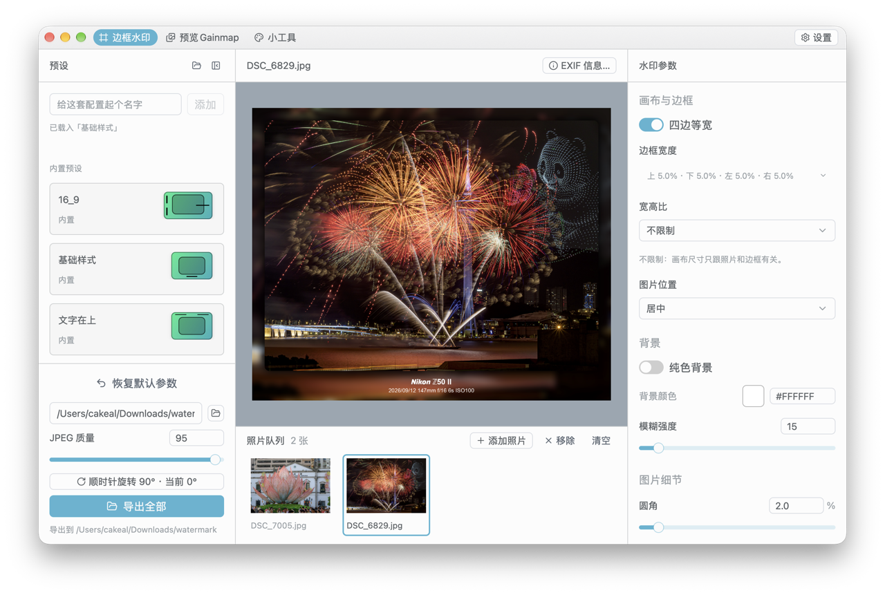
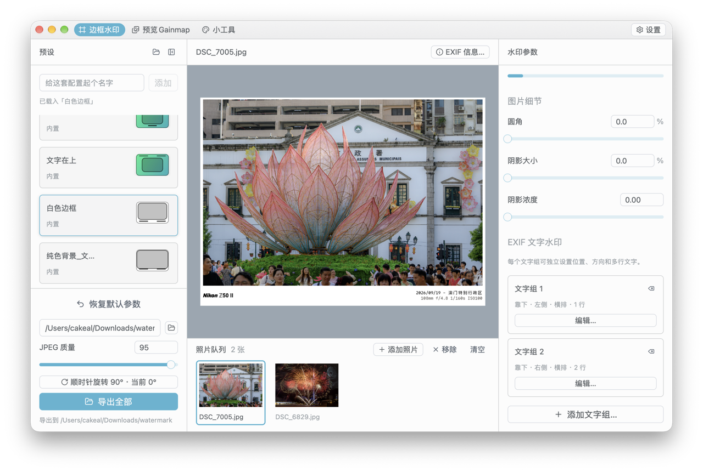
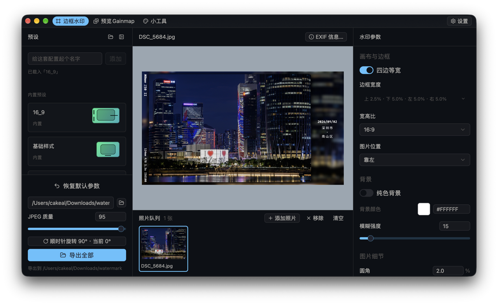
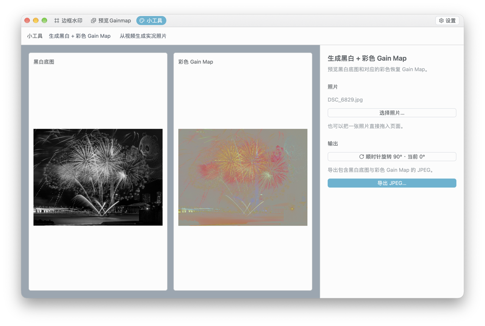
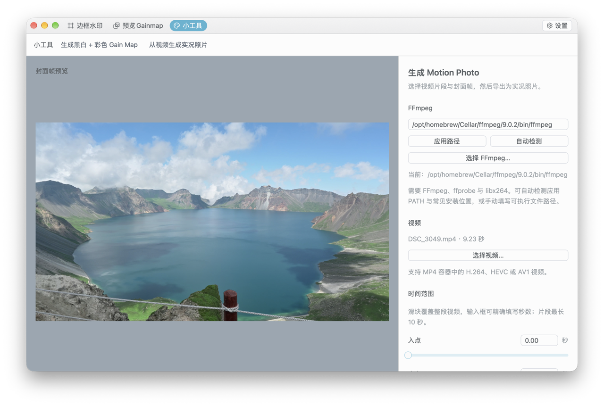

# Lumen Frame

Lumen Frame 是一款添加边框水印的工具。  
它还提供 Ultra HDR Gain Map 查看、黑白底图与彩色 Gain Map 生成，以及从视频制作 Motion Photo 的小工具。

产品介绍与下载：[Lumen Frame 网站](https://cakeal.github.io/lumen-frame/)。

## 特色

1. 灵活调整文字的位置（通过文字组），可以在照片的上面下面左面右面，以及另外一个文字组的上下左右！并且可以加边框。
2. 可以导出固定比例的照片，比如16:9，而且可以自由决定照片的放置位置（比如靠左）。
3. Exif 可以编辑，应用到导出。
4. 自动根据照片GPS信息识别省市区（限中国区域（含港澳台））；支持通过地图选点添加 GPS，并写入导出图片。
5. 内置部分预设，也可以保存自己的边框水印预设。
6. 提取色卡（并支持若干种风格），并应用到背景渐变，或放置在任何地方。
7. 自定义logo，支持与文字灵活排版。
8. 如果原图含HDR Gain Map，导出的水印同时保留HDR Gain Map (此时图片大小会限制在 8192x8192，由于`libultrahdr`限制)。
9. 提供小工具，生成Motion Photo（实况照片）以及“黑白 + 彩色Gain Map”的照片。
10. 支持 MCP，可使用AI Agent操作软件，批量处理照片。
11. 不含任何恼人的Web技术 (Chromium 以及 Electron)，UI使用 `gpui-kit` 构建，照片处理使用`vips`。

## 界面预览

默认样式：



白色边框样式：



宽高比设置为16:9，左侧竖排文字，右侧显示时间和地区的样式：



生成黑白 + 彩色 Gain Map：



从视频生成 Motion Photo (需要手动指定FFmpeg的文件路径，本体不自带)：



## 下载与使用

[GitHub Releases](https://github.com/CakeAL/lumen-frame/releases) 下载与设备匹配的版本：

| 平台 | 下载文件 | 使用方式 |
| --- | --- | --- |
| macOS Apple Silicon | `Lumen-Frame-<版本>-macOS-arm64.dmg` | 打开 DMG，将应用拖入“应用程序” |
| macOS Intel | `Lumen-Frame-<版本>-macOS-x86_64.dmg` | 打开 DMG，将应用拖入“应用程序” |
| Windows x86-64 | `Lumen-Frame-<版本>-Windows-x86_64.zip` | 解压整个文件夹后运行 `lumen-frame.exe`；不要只复制 exe |
| Linux | 无 | 自行从源代码构建 |

macOS 安装包目前采用临时签名，首次打开如被系统拦截，可在 Finder 中右键应用并选择“打开”。Windows 安装包使用精简版 libvips，支持 AVIF，不接受 HEIC 和相机 RAW；macOS 使用 Homebrew 的完整 libvips，相关格式仍建议用实际照片验证。

<details>
<summary>其他需要注意的是</summary>
边框水印和 Gain Map 功能不需要 FFmpeg。使用 Motion Photo 前，需另行安装包含 `ffprobe` 和 `libx264` 的 FFmpeg。应用会自动检测 PATH 与常见安装位置，也可以在小工具页面手动指定 `ffmpeg` 可执行文件。输入为 MP4；导出时视频统一编码为 H.264，以提高兼容性。Motion Photo 是否能播放还取决于目标相册或平台，建议导出后在目标设备上确认。

更改 GPS 信息：选中照片 → 点击「EXIF 信息」右侧的「更改GPS信息」，搜索地点或点击地图，也可手动输入 WGS 84 经纬度。点击「使用此位置」直接应用。修改只作用于这张队列照片，导出的 JPEG 包含 GPS；在「EXIF 信息」中清空 GPS 输入并应用可移除位置，原图不变。

地图采用 `cartography` 原生渲染。在地图窗口选择「地图源」并点击「应用地图源」，可切换 OpenStreetMap 和腾讯地图公开瓦片；选择会保存到应用配置。内置来源无需申请 Key，腾讯公开瓦片地址未提供稳定接口承诺，服务变化时可切换其他来源。腾讯底图使用 GCJ-02，应用通过 `coordtransform` 转换显示和选点坐标，手动输入、EXIF 和导出 GPS 始终使用 WGS 84。

地图与地点搜索独立，搜索仍使用 Photon，切换腾讯底图不会更换搜索服务。在线功能只请求地图瓦片和提交搜索词，不上传照片；地图瓦片按服务端缓存期限保存在本机缓存目录；地图窗口支持「清理地图瓦片缓存」和「打开缓存文件夹」，清理会删除所有地图源的缓存。`LUMEN_FRAME_GEOCODER_URL` 可替换兼容 Photon API 的搜索服务。

（Motion Photo和HDR已在小红书/小米15相册播放测试过。）
</details>

## 使用 AI Agent 操作软件（MCP）

Lumen Frame 可以通过 MCP 让 AI Agent 调整背景、边框、阴影、文字组、色卡和 EXIF，管理照片队列并导出图片。AI 的修改会同步到当前打开的软件窗口，可以一边查看预览，一边继续手动调整。

首次使用需要在 Agent 客户端中配置一次 MCP，之后就可以直接用自然语言操作。Lumen Frame 本身不需要配置模型 API Key，模型由 Agent 客户端提供。

### 1. 准备软件和客户端

- 安装支持 MCP 的 Lumen Frame 版本（>=1.2.0），正常打开软件并导入照片。
- 使用支持**本地 stdio MCP** 的 Agent 客户端。客户端需要能够在运行 Lumen Frame 的同一台电脑上启动程序。

### 2. 添加 MCP 服务

在客户端的 MCP 设置中添加一个本地服务，传输方式选择 `stdio`，程序路径填写 Lumen Frame 的可执行文件，启动参数填写 `--mcp-stdio`。服务名称可以填 `lumen-frame`。

<details>
<summary>mcpServers JSON 配置</summary>

**macOS**：应用安装在“应用程序”目录时：

```json
{
  "mcpServers": {
    "lumen-frame": {
      "command": "/Applications/Lumen Frame.app/Contents/MacOS/lumen-frame",
      "args": ["--mcp-stdio"]
    }
  }
}
```

**Windows**：将下面的路径替换为实际解压位置，保留安装包中的 DLL 和其他配套文件：

```json
{
  "mcpServers": {
    "lumen-frame": {
      "command": "D:\\Apps\\Lumen Frame\\lumen-frame.exe",
      "args": ["--mcp-stdio"]
    }
  }
}
```

`command` 使用完整的可执行文件路径，`args` 单独填写参数；JSON 中的 Windows 反斜杠需要写成 `\\`。保存后，在客户端重新加载 MCP 服务或重启客户端，确认能够看到 Lumen Frame 的工具列表。
</details>

<details>
<summary>Codex 配置</summary>

在 `~/.codex/` 的 `config.toml` 中添加可执行文件（Windows为对应的exe）：
```toml
[mcp_servers.lumen-frame]
command = "/Applications/Lumen Frame.app/Contents/MacOS/lumen-frame"
args = ["--mcp-stdio"]
```

</details>

<details>
<summary>Deepseek Harness 配置</summary>

在 `~/.dsh` 的 `cordis.patch.yml` 中添加可执行文件（Windows为对应的exe）：
```yml
- insert:
    - id: mcp-lumen-frame
      name: '@deepseek-ai/dsh-mcp-client'
      config:
        serverName: lumen_frame
        transport: stdio
        command: '/Applications/Lumen Frame.app/Contents/MacOS/lumen-frame'
        args: ['--mcp-stdio']
```

</details>


### 3. 让 Agent 操作当前照片

连接成功后，可以这样描述需求：

> 使用 Lumen Frame，先读取当前工作区，把当前照片的背景改成 135° 渐变，颜色使用 #b5b9ff 和 #2b2c49，阴影改成白色。先预览，等我确认后再导出。  

> 将当前照片的设置应用到所有照片，保留每张照片各自的自定义文本。  

> 把当前照片的拍摄参数放在照片下方居中显示，并在右侧添加一排圆形色卡。

> 把 /Users/cakeal/Downloads/香港铁路博物馆 这个文件夹导入到lumen frame，使用预设16:9全部导出到 ~/Downloads/香港铁路博物馆/watermark

操作期间保持 Lumen Frame 窗口打开。关闭软件后，Agent 会收到连接错误；重新打开软件后，可以让 Agent 重新读取工作区，再继续操作。

### 常见问题

- **客户端没有显示工具**：检查程序路径和 `--mcp-stdio` 参数，确认使用支持 MCP 的软件版本，再重新加载服务。
- **提示无法连接桌面**：先正常打开 Lumen Frame。配置中的程序路径应指向同一套软件。
- **提示状态已更新或版本冲突**：你可能同时手动调整了照片，让 Agent 重新读取当前工作区后再提交修改。

需要独立的无窗口批量处理时，可将 `args` 改为 `["--mcp-stdio", "--mcp-headless"]`。该模式使用独立工作区，处理结果不会同步到桌面窗口。更多启动参数及工具说明见 [MCP 接入说明](docs/mcp.md)。

## 开发

需要较新的稳定版 Rust 及本机可用的 libvips (参考：https://github.com/houseme/vips-sys/blob/main/README_CN.md)。

```bash
# macOS
brew install vips
cargo run
```

Windows 构建需要 vcpkg 和 libvips 8.16.6 (vips-dev-x64-web-8.18.6.zip)。  

vcpkg 需要手动 overlay 安装 vips-dev-x64-web-8.18.6 （vcpkg 最新的 vips 是 `8.18.5`，没有`.6`，然后，`vips-sys`的库可能识别 vcpkg 的 port 有错误，应是 `libvips`，但是却识别 `vips`）

```bash
# Windows
vcpkg install vips:x64-windows --overlay-ports=.\vcpkg-overlay
# 手动在 .cargo/config.toml 设置 vcpkg 文件夹
cargo run
```

完整的依赖准备、macOS DMG 与 Windows ZIP 打包步骤见 [打包文档](docs/packaging.md)；代码模块说明见 [架构文档](docs/architecture.md)。

## 反馈

发现问题或希望增加功能，欢迎前往 [GitHub Issues](https://github.com/CakeAL/lumen-frame/issues)。
